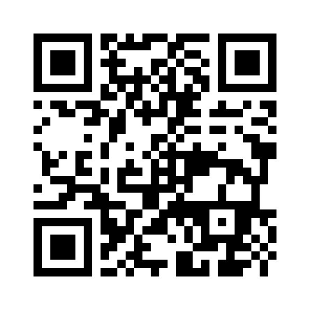

# Support HomePodCast

HomePodCast is free and open source (GPL-3.0), and one person maintains it in their spare time. Nothing in the app is
locked, and a donation buys no extra features: it is a thank-you that helps pay for the tools the project is built with.

Ways to help that cost nothing:

- Star the [repository](https://github.com/qiyinxi/HomePodCast), so others find it.
- Report what does not work, with the log, in [Issues](https://github.com/qiyinxi/HomePodCast/issues).

## Donate

On Afdian (爱发电; WeChat Pay and Alipay): <https://ifdian.net/a/qiyinxi>, or scan the code:

The page is the maintainer's own, shared with their other open-source projects.

Microsoft is not the fundraiser or sponsor of these donations.

---

# 赞赏 HomePodCast

HomePodCast 免费、开源（GPL-3.0），由一个人用业余时间维护。程序里没有任何要付费才能用的功能，赞赏也不会换来额外的功能：它是一份心意，用来抵开发这个项目所用工具的开销。

不花钱也能帮上忙：

- 给[仓库](https://github.com/qiyinxi/HomePodCast)点个星星，让更多人看到它。
- 遇到问题时带上日志，在 [Issues](https://github.com/qiyinxi/HomePodCast/issues) 里告诉我。

## 赞赏

爱发电（支持微信和支付宝）：<https://ifdian.net/a/qiyinxi>，也可以扫码：

这是维护者个人的主页，和其他开源项目共用。

这些赞赏与 Microsoft 无关，Microsoft 不是募款方或赞助方。
